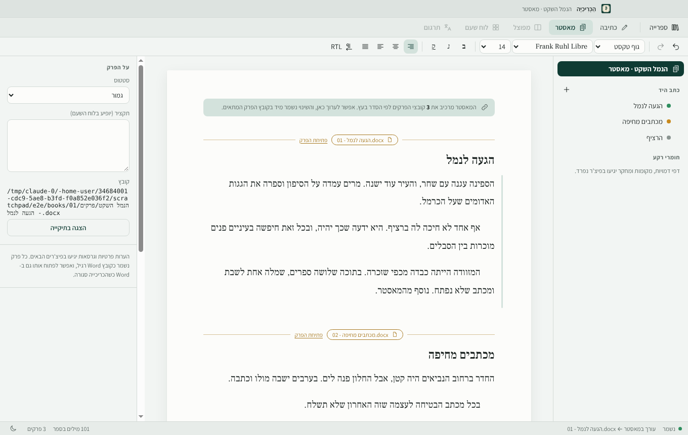

# הכריכייה

מעבד תמלילים לכתיבת ספרים, לווינדוס. כל ספר הוא תיקייה במחשב, וכל פרק הוא קובץ Word (docx) נפרד.

## איך מנסים את האפליקציה

אין צורך להתקין שום דבר חוץ מהאפליקציה עצמה.

**אחרי שמיזגו שינוי ל-main:** בעמוד [Releases](../../releases/latest) מורידים את `HaKirchia-Setup-….exe` (התקנה רגילה) או `HaKirchia-Portable-….exe` (בלי התקנה, פשוט מפעילים).

**כדי לנסות PR לפני מיזוג:** בעמוד ה-PR, בלשונית **Checks**, נכנסים לריצה "בנייה לווינדוס". בתחתית העמוד, תחת **Artifacts**, מורידים את `HaKirchia-Windows`. זה קובץ zip: פותחים אותו ומפעילים את הקובץ Portable.

בפעם הראשונה Windows עשוי להציג "Windows protected your PC", כי האפליקציה עוד לא חתומה דיגיטלית. לוחצים **More info** ואז **Run anyway**.

## איך ספר נשמר בדיסק

```
הנמל השקט\
  book.hakirchia.json        רשימת הפרקים, הסדר, החלקים, הסטטוס והתקציר
  פרקים\
    01 - הפתיחה.docx
    02 - מכתבים מחיפה.docx
```

- שם הקובץ נגזר ממספר הפרק ומשמו, ומתעדכן כשמשנים שם או סדר.
- בתוך כל קובץ, השורה הראשונה היא שם הפרק בסגנון "Heading 1" של Word.
- מחיקת פרק מעבירה את הקובץ לסל המחזור.
- אם פותחים פרק שנערך ב-Word ויש בו דברים שהעורך עוד לא מכיר (תמונה, טבלה, הערת שוליים), הפרק נפתח לקריאה בלבד עד שמאשרים, ולפני השמירה הראשונה נשמר עותק של המקור בתיקייה "גיבוי קבצים מקוריים".

## קובץ המאסטר

הלשונית **מאסטר** (או השורה הראשונה בעץ) מציגה את כל הפרקים ברצף, לפי הסדר בעץ. המאסטר לא שומר עותק משלו: כל קטע בו הוא קובץ הפרק עצמו, כך שמה שכותבים במאסטר נשמר מיד בקובץ הפרק, ומה שכותבים בפרק מופיע במאסטר. גם שינוי שנשמר בקובץ מחוץ לכריכייה (למשל ב-Word) מופיע מעצמו, כל עוד אין באותו פרק הקלדה שעוד לא נשמרה.

## חלקים ועץ הפרקים

- גוררים פרק בעץ כדי לשנות את הסדר. גרירה על שורת חלק מכניסה את הפרק לחלק; גרירה לקצה העליון של שורת החלק שמה אותו לפני החלק.
- כפתור "חלק חדש" ליד הפלוס יוצר חלק ריק. בקליק ימני על פרק: "חלק חדש מהפרק הזה" (החלק כולל את הפרק הזה ואת אלה שאחריו), "העברה לחלק", "הוצאה מהחלק".
- גוררים שורת חלק כדי להזיז את כל החלק עם הפרקים שבו. קליק על החלק סוגר ופותח אותו.
- הסרת חלק לא מוחקת שום פרק: הפרקים נשארים במקומם.
- החלקים נשמרים ב-`book.hakirchia.json`. קובצי הפרקים נשארים בתיקייה אחת, ממוספרים ברצף לפי הסדר בעץ. במאסטר מופיע שם החלק לפני הפרקים שלו.

## קיצורי מקלדת כמו ב-Word

| קיצור | פעולה |
| --- | --- |
| Ctrl+R / Ctrl+L | יישור לימין / לשמאל |
| Ctrl+E | מרכוז |
| Ctrl+J | יישור לשני הצדדים |
| Ctrl + Shift הימני | פסקה מימין לשמאל (RTL) |
| Ctrl + Shift השמאלי | פסקה משמאל לימין (LTR) |

## הזחה כמו בספר

כל פסקה מקבלת הזחה בשורה הראשונה, חוץ מהפסקה הראשונה בפרק, הראשונה אחרי כותרת, אחרי שורה ריקה או אחרי שורה ממורכזת (כמו `* * *`). אותו כלל נשמר בקובץ ה-Word: לפסקאות בלי הזחה יש סגנון "First Paragraph".



## לפיתוח

Electron + React + TypeScript, עורך [TipTap](https://tiptap.dev) (ProseMirror). ההמרה ל-docx ובחזרה ב-`src/shared/docx.ts`.

```
npm install
npm run dev        # הרצה בזמן פיתוח
npm test           # בדיקות ההמרה ל-Word
npm run dist:win   # בניית קובץ התקנה (רץ אוטומטית ב-GitHub Actions)
```
