# הכריכייה

מעבד תמלילים לכתיבת ספרים, לווינדוס. כל ספר הוא תיקייה במחשב, וכל פרק הוא קובץ Word (docx) נפרד.

## איך מנסים את האפליקציה

אין צורך להתקין שום דבר חוץ מהאפליקציה עצמה.

**אחרי שמיזגו שינוי ל-main:** בעמוד [Releases](../../releases/latest) מורידים את `HaKirchia-Setup-….exe` (התקנה רגילה) או `HaKirchia-Portable-….exe` (בלי התקנה, פשוט מפעילים).

**כדי לנסות PR לפני מיזוג:** בעמוד ה-PR, בלשונית **Checks**, נכנסים לריצה "בנייה לווינדוס". בתחתית העמוד, תחת **Artifacts**, מורידים את `HaKirchia-Windows`. זה קובץ zip: פותחים אותו ומפעילים את הקובץ Portable.

בפעם הראשונה Windows עשוי להציג "Windows protected your PC", כי האפליקציה עוד לא חתומה דיגיטלית. לוחצים **More info** ואז **Run anyway**.

## איך ספר נשמר בדיסק

```
הנמל השקט\
  book.hakirchia.json        רשימת הפרקים, הסדר, החלקים, הסטטוס והתקציר
  פרקים\
    01 - הפתיחה.docx
    02 - מכתבים מחיפה.docx
  גרסאות\                   גרסאות של כל פרק (קובצי Word), בתיקייה לכל פרק
  טיוטות חלופיות\           נוסחים חלופיים של פרקים וסצנות (קובצי Word)
  מגירה.json                 טקסט שנחתך או נמחק
  מקור\                     קובצי ה-PDF של הספר המקורי (בספר מתורגם)
```

- שם הקובץ נגזר ממספר הפרק ומשמו, ומתעדכן כשמשנים שם או סדר.
- בתוך כל קובץ, השורה הראשונה היא שם הפרק בסגנון "Heading 1" של Word.
- מחיקת פרק מעבירה את הקובץ לסל המחזור.
- אם פותחים פרק שנערך ב-Word ויש בו דברים שהעורך עוד לא מכיר (תמונה, טבלה, הערת סיום), הפרק נפתח לקריאה בלבד עד שמאשרים, ולפני השמירה הראשונה נשמר עותק של המקור בתיקייה "גיבוי קבצים מקוריים".

## הספר כולו

הלשונית **הספר כולו** (או השורה הראשונה בעץ) מציגה את כל הפרקים ברצף, לפי הסדר בעץ. אין לה עותק משלה: כל קטע בה הוא קובץ הפרק עצמו, כך שמה שכותבים בה נשמר מיד בקובץ הפרק, ומה שכותבים בפרק מופיע בה. גם שינוי שנשמר בקובץ מחוץ לכריכייה (למשל ב-Word) מופיע מעצמו, כל עוד אין באותו פרק הקלדה שעוד לא נשמרה.

## חלקים ועץ הפרקים

- גוררים פרק בעץ כדי לשנות את הסדר. גרירה על שורת חלק מכניסה את הפרק לחלק; גרירה לקצה העליון של שורת החלק שמה אותו לפני החלק.
- כפתור "חלק חדש" ליד הפלוס יוצר חלק ריק. בקליק ימני על פרק: "חלק חדש מהפרק הזה" (החלק כולל את הפרק הזה ואת אלה שאחריו), "העברה לחלק", "הוצאה מהחלק".
- גוררים שורת חלק כדי להזיז את כל החלק עם הפרקים שבו. קליק על החלק סוגר ופותח אותו.
- הסרת חלק לא מוחקת שום פרק: הפרקים נשארים במקומם.
- החלקים נשמרים ב-`book.hakirchia.json`. קובצי הפרקים נשארים בתיקייה אחת, ממוספרים ברצף לפי הסדר בעץ. בתצוגת הספר כולו מופיע שם החלק לפני הפרקים שלו.

## לוח השעם

הלשונית **לוח שעם** מציגה כרטיס לכל פרק, לפי הסדר בעץ ומחולק לחלקים: מספר הפרק, כמות המילים, השם, התקציר והסטטוס (הפס הצבעוני למעלה הוא צבע הסטטוס).

- לחיצה על התקציר עורכת אותו ישר בכרטיס (נשמר כשיוצאים מהתיבה, Esc מבטל). זה אותו תקציר שבחלונית "על הפרק".
- לחיצה על הסטטוס משנה אותו. הכפתורים למעלה מסננים לפי סטטוס.
- גרירת כרטיס משנה את סדר הפרקים, בדיוק כמו גרירה בעץ: גם הספר כולו ומספרי הקבצים מתעדכנים. גרירה לשם של חלק או לכרטיס הריק שבסופו מכניסה את הפרק לחלק.
- לחיצה כפולה על כרטיס (או על העיפרון) פותחת את הפרק לכתיבה. לחיצה על שם הפרק בכרטיס משנה את השם. קליק ימני פותח את אותו תפריט כמו בעץ.

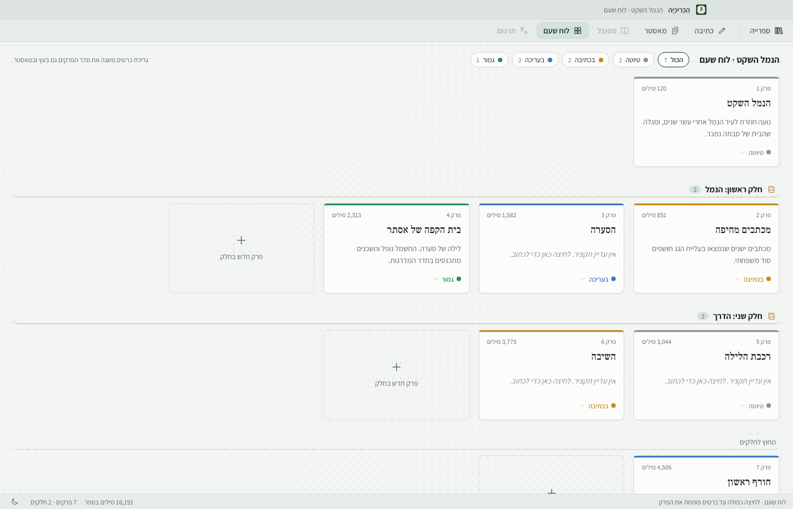

## כמה חלונות זה לצד זה

בלשונית **כתיבה** אפשר לפתוח עד שלושה חלונות זה לצד זה. כל חלון מציג פרק או את הספר כולו, ואפשר לכתוב בכל אחד מהם.

| קיצור | פעולה |
| --- | --- |
| Ctrl+Shift+N | חלון נוסף, לצד החלון הפעיל |
| Ctrl+Shift+X או Ctrl+W | סגירת החלון הפעיל |
| Ctrl+Shift+I | פתיחה וסגירה של "על הפרק" בחלון הפעיל, כשיש כמה חלונות |
| Ctrl+פלוס / Ctrl+מינוס / Ctrl+0 | הגדלה, הקטנה וחזרה ל-100% של כל התצוגה |

- בראש כל חלון בוחרים מה הוא מציג, ורואים כמה מילים יש בו. לחיצה על פרק בעץ פותחת אותו בחלון הפעיל, ואפשר גם לגרור פרק מהעץ אל חלון.
- ⇄ מחליף מקום בין שני חלונות. גרירת הגבול ביניהם משנה את הרוחב, ולחיצה כפולה עליו מחזירה רוחב שווה.
- כשיש כמה חלונות, "על הפרק" מוסתר. הכפתור ⓘ בראש כל חלון שולף אותו בתוך אותו חלון, והוא נסגר לבד כשחוזרים לכתוב.
- אותו פרק יכול להיות פתוח בשני חלונות: מה שמקלידים באחד מופיע מיד בשני, והקובץ נשמר פעם אחת.
- הכריכייה זוכרת את החלונות של כל ספר.

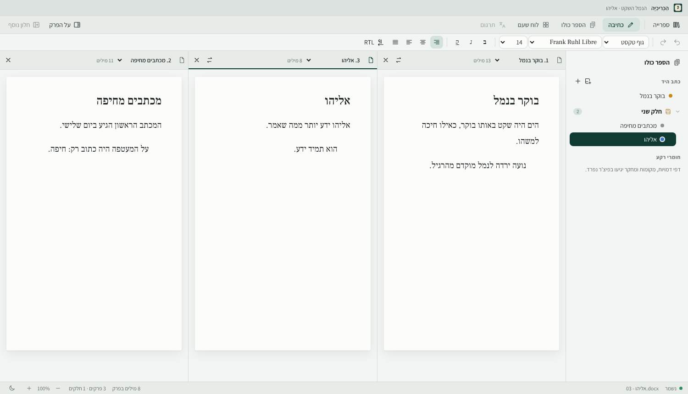

## ניווט: חיפוש, מעבר מהיר, סצנות וסימניות

| קיצור | פעולה |
| --- | --- |
| Ctrl+F | חיפוש בכל הספר |
| Ctrl+H | חיפוש והחלפה בכל הספר |
| Enter / Shift+Enter (או F3) | המופע הבא / הקודם |
| Ctrl+P | מעבר מהיר לפרק, חלק, סימנייה או סצנה |
| Ctrl+Shift+Enter | מעבר סצנה (`* * *`) |
| Alt+PageDown / Alt+PageUp | הסצנה הבאה / הקודמת |
| Ctrl+Shift+K (ל) | סימנייה "לחזור לכאן" (שוב באותו מקום: הסרה) |

- **חיפוש והחלפה** נפתח משמאל, במקום "על הפרק". האפשרויות: בלי להתחשב בניקוד (מופעל מראש), מילה שלמה, וגם עם אותיות השימוש ו, ה, ב, כ, ל, מ, ש לפני המילה (כך "דני" מוצא גם "ולדני", ורק "דני" מוחלף), ורק בפרק הפתוח. כל המופעים מסומנים בטקסט, ולחיצה על תוצאה קופצת אליה. "החלפת הכול" עובדת גם על פרקים סגורים, ואפשר לבטל אותה מיד בכפתור "ביטול ההחלפה". פרקים שפתוחים לקריאה בלבד לא משתנים.
- **מעבר סצנה** הוא פסקה רגילה עם `* * *` באמצע השורה, כך שהקובץ נשאר Word רגיל. גם `***` שמקלידים בשורה ריקה הופך למעבר סצנה (Backspace מיד אחרי מחזיר), ומעברים שנכתבו ב-Word (`***`, `⁂`, `#`) מזוהים. הסצנות של הפרק הפתוח מופיעות בעץ מתחת לפרק, והסצנה שבה הסמן מודגשת.
- **סימניות** נשמרות בקובץ הספר, עם הטקסט שסביבן, כך שהן נמצאות גם אחרי עריכה (גם ב-Word). בטקסט הן מופיעות כסרט זהב קטן, והרשימה כולה נמצאת בעץ מתחת לפרקים: לחיצה קופצת, לחיצה כפולה משנה את השם.

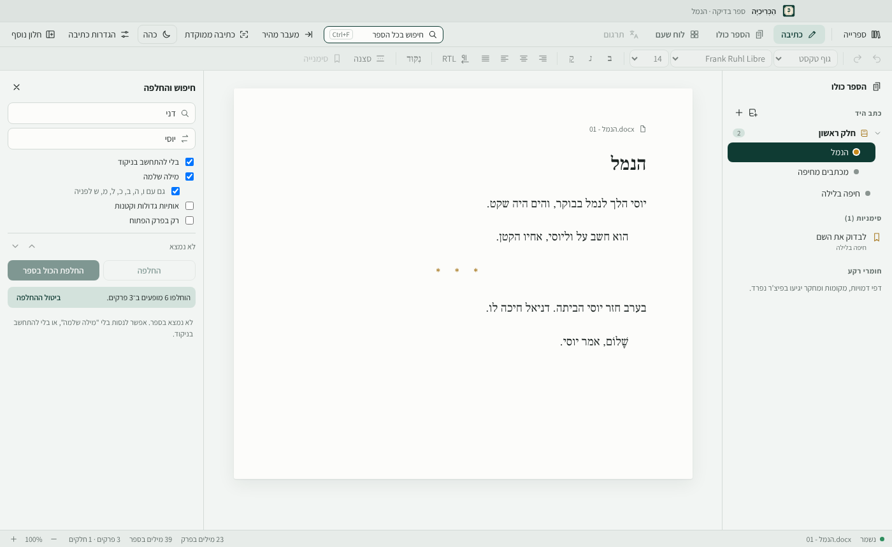
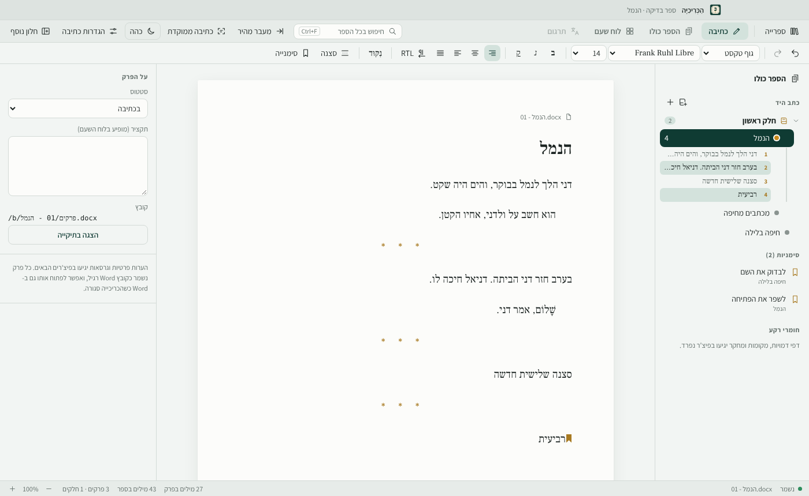

## שמירה וטיוטות: גרסאות, הערות, מגירה וטיוטות חלופיות

| קיצור | פעולה |
| --- | --- |
| Ctrl+Alt+F | הערת שוליים במקום הסמן (כמו ב-Word) |
| Ctrl+Alt+M | הערה פרטית על המילים המסומנות (או על הפרק) |
| Ctrl+Shift+M (צ) | העברת הטקסט המסומן למגירה. בלי סימון: פתיחת המגירה |

- **גרסאות** (ב"על הפרק"): תוך כדי כתיבה הכריכייה שומרת בעצמה גרסה של הפרק כמו שהיה, פעם בחצי שעה לכל היותר. כפתור השעון שומר גרסה עם שם ("לפני שינוי הפתיחה"). **השוואה** מראה מה נוסף (ירוק) ומה נמחק (אדום), מילה במילה. **שחזור** מחזיר את הפרק לגרסה, ואחרי ששומר קודם את הטקסט של עכשיו כגרסה "לפני שחזור" (ואפשר גם Ctrl+Z).
- **הערות שוליים** מופיעות כמספר קטן בטקסט, והטקסט שלהן נכתב בתחתית הפרק. לחיצה על המספר עוברת להערה, ולחיצה על המספר שליד ההערה חוזרת לטקסט. בקובץ ה-Word הן הערות שוליים אמיתיות, וגם הערות שוליים שנכתבו ב-Word נפתחות (כטקסט פשוט).
- **הערות פרטיות** (ב"על הפרק") הן הערות לעצמך: על מילים מסומנות (הן מודגשות בטקסט) או על הפרק כולו. הן נשמרות בקובץ הספר, לא בקובץ הפרק, ולא ייכנסו לייצוא.
- **מגירה** (בסרגל העליון): כל טקסט שנחתך ב-Ctrl+X, או מחיקה של 4 מילים ומעלה, נשמר במגירה. "החזרה לטקסט" מכניסה אותו במקום שבו הסמן נמצא. אפשר לכבות את השמירה האוטומטית במגירה עצמה.
- **טיוטות חלופיות** (ב"על הפרק"): עותק של הפרק, או של הסצנה שבה הסמן נמצא, שנפתח בחלון ליד המקור לכתיבת נוסח אחר. **השוואה** מראה מה שונה, ו**בחירה** מכניסה את הטיוטה לפרק (או רק לסצנה), אחרי שהנוסח הקודם נשמר בגרסאות.

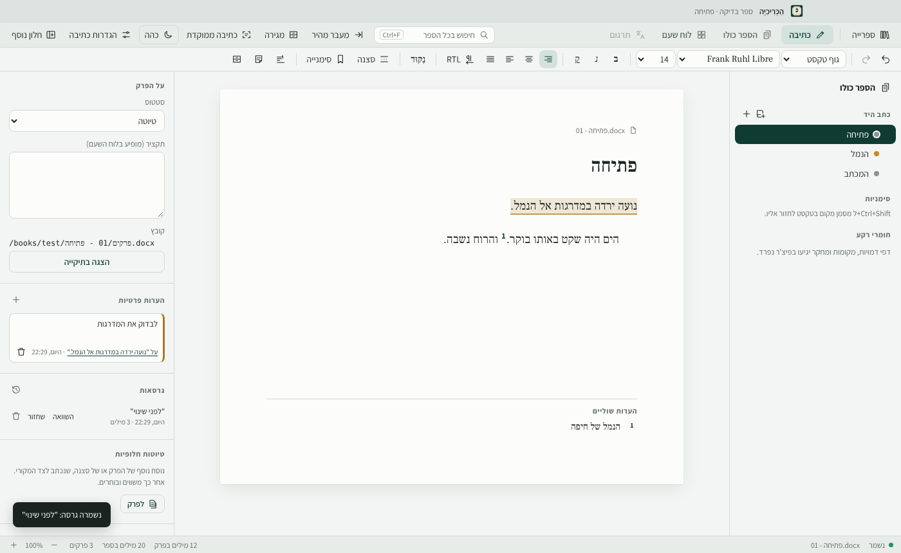
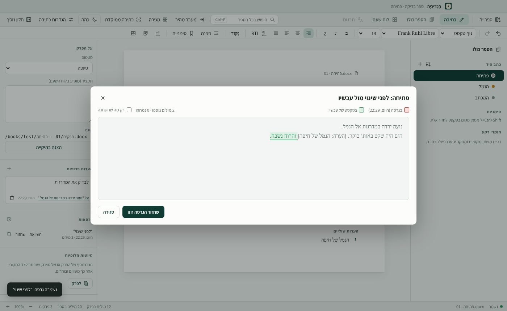
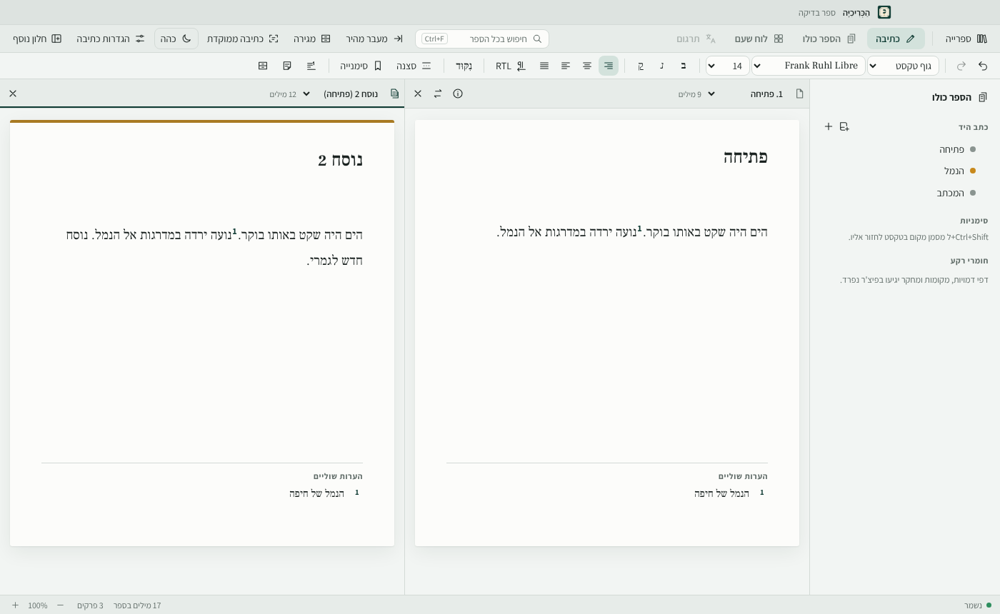

## תרגום: המקור, גוגל תרגום והתקדמות

לשונית **תרגום** פותחת שלושה חלונות זה לצד זה: הפרק, המקור שלו (PDF) וגוגל תרגום. אלה חלונות רגילים כמו בכתיבה: גוררים את הגבולות, מחליפים מקומות, סוגרים או מוסיפים חלון, ובוחרים בכל חלון מה הוא מציג (גם "המקור (PDF) של הפרק" ו"גוגל תרגום" ברשימה). הפריסה של מסך התרגום נשמרת לחוד, ו"כתיבה" חוזרת לחלונות שהיו בה.

| קיצור | פעולה |
| --- | --- |
| Ctrl+Shift+T (א) | שליחת הטקסט המסומן לגוגל תרגום |

- **המקור**: בפעם הראשונה בוחרים קובץ PDF, וההעתק שלו נשמר בתיקייה "מקור" של הספר. חלון ה-PDF תמיד מציג את המקור של הפרק שנמצא בחלון הפעיל.
- **איפה הפרק במקור**: לוחצים על פסקה ב-PDF ואז **כאן מתחיל הפרק** או **כאן נגמר הפרק**. פרק חדש שמקושר לאותו PDF מתחיל מעצמו אחרי סוף הפרק הקודם. פסקאות מחוץ לפרק מוצגות באפור.
- **גלילה מסונכרנת לפי פסקאות**: הפסקה שבראש הפרק מביאה את בת הזוג שלה במקור, ולהפך. שם הפרק מתאים לפסקה הראשונה של הפרק במקור (בדרך כלל הכותרת). מעבר עכבר על פסקה מדגיש את בת הזוג שלה בצד השני. הכפתור **מסונכרן** מכבה ומדליק.
- **גוגל תרגום**: האתר הרגיל בתוך החלון, בלי API. סימון טקסט ב-PDF ולחיצה על **לתרגום** (או בלי סימון: הפסקה שנבחרה) פותחים אותו שם. התרגום לא נכנס לפרק מעצמו. רק גוגל תרגום נפתח בתוך הכריכייה, וכל קישור אחר נפתח בדפדפן.
- **התקדמות** (נתון בלבד, בלי יעדים): כמה פסקאות של הפרק המקורי כבר יש בתרגום. מופיעה בחלון ה-PDF, באחוזים ליד הפרק בעץ, ב"על הפרק", ולכל הספר בשורת המצב. ב-PDF מסומן בצהוב "עד כאן" ליד הפסקה הראשונה שעוד לא תורגמה.
- במצב כהה ה-PDF מוצג הפוך כדי לא לסנוור.
- **זיהוי פרקים וסצנות במקור**: הכריכייה מחפשת ב-PDF איפה מתחילים פרקים (כותרת באות גדולה, "Chapter 3", ספרה רומית לבד) ומסמנת אותם ב"פרק?". כשסוף הפרק עוד לא נקבע, מופיעה הצעה בפס צהוב ("נראה שהפרק מתחיל ב... ונגמר לפני...") עם **לקבוע כך**. מעברי סצנה במקור (שורת כוכביות, כוכבית אחת, או קישוט קטן בין פסקאות) מסומנים בקו מקווקו "סצנה", ולא נספרים כפסקאות.
- **חלוקת הספר כולו לפרקים לפי המקור**: כשב-PDF זוהו כמה פרקים, הכפתור **חלוקה לפרקים** יוצר מסמך לכל פרק (מסמנים אילו), מקושר לחלק שלו במקור, עם שורת * * * בכל מעבר סצנה ומקום ריק לתרגום. פרק ריק שפתוח עכשיו הופך לראשון. מחיקת פרק שנוצר בטעות (למשל "תודות") מוחקת רק את הקישור שלו, וה-PDF ושאר הפרקים לא משתנים.

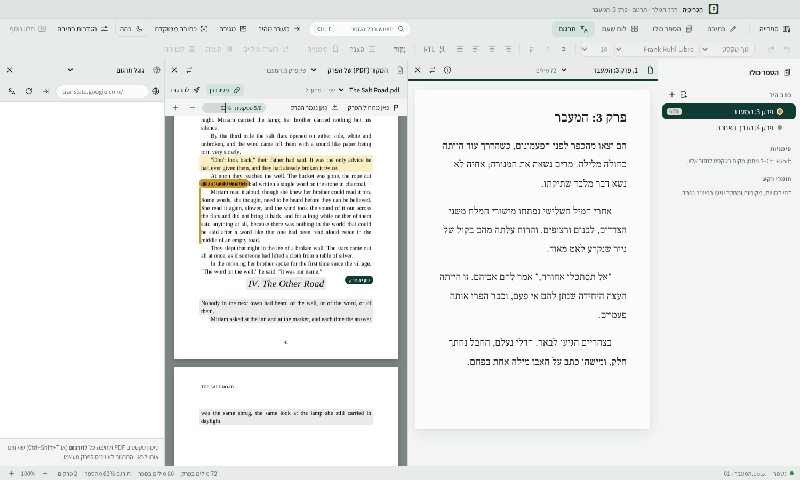
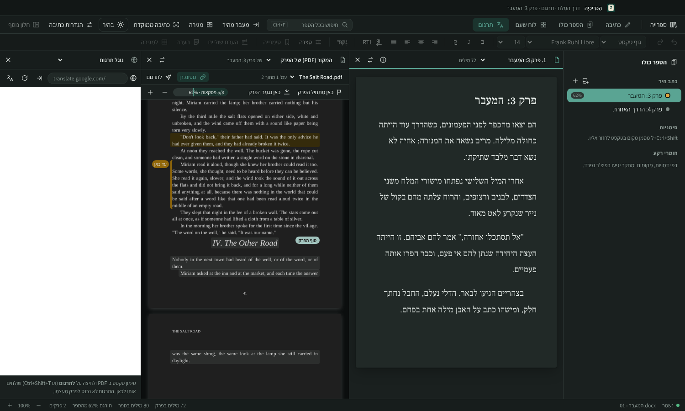
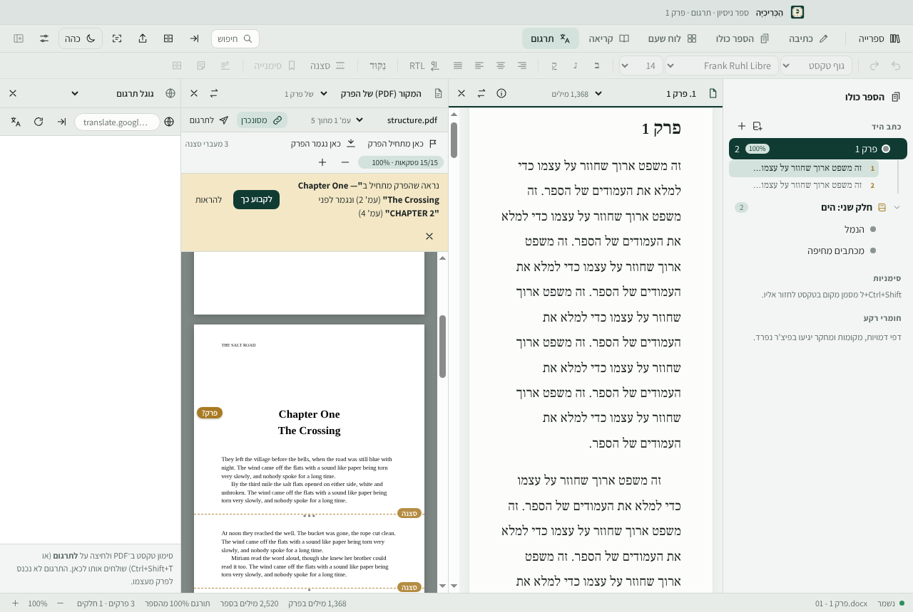

## קריאה וייצוא

- **מצב קריאה** (לשונית **קריאה**): הספר כמו ספר מודפס, עמוד מול עמוד, בלי כלי עריכה. עמוד 1 לבד משמאל, כמו בספר עברי. חץ שמאלה, גלגלת או לחיצה על הצד השמאלי מעבירים קדימה. לחיצה כפולה על הטקסט פותחת את הפרק לכתיבה. העימוד זהה ל-PDF, כך שזו גם תצוגה מקדימה להדפסה.
- **עימוד** (כפתור בפס העליון של מצב הקריאה): גודל עמוד, גופן, גודל אות, רווח בין שורות, ומתגים: כל כותרת חלק בעמוד משלה באמצע העמוד, כל פרק בעמוד חדש, פרק תמיד בעמוד שמאלי (נוסף עמוד ריק כשצריך), יישור לשני הצדדים, מספרי עמודים, שם הספר ושם הפרק בראש העמוד. ההגדרות נשמרות בספר.
- **עמודי פתיחה וסיום**: שער (שם, כותרת משנה, כותב), זכויות יוצרים, הקדשה, מוטו, תוכן עניינים (נבנה לבד, עם מספרי עמודים), תודות, על הכותב, או עמוד אחר. נכנסים לקריאה ולכל ייצוא, ולא נספרים כפרקים.
- **ייצוא** (כפתור בפס העליון): **PDF להדפסה** (עימוד ספר, כותרות רצות, מספרי עמודים, תוכן עניינים עם עמודים, הגופנים מוטמעים), **קובץ Word אחד** (כל הספר מאוחד, הערות שוליים אמיתיות, תוכן עניינים ש-Word מעדכן כשהקובץ נפתח), **ePub** (לקוראים אלקטרוניים, מימין לשמאל). הקבצים נשמרים בתיקייה "ייצוא" של הספר, וההערות הפרטיות אף פעם לא נכנסות.

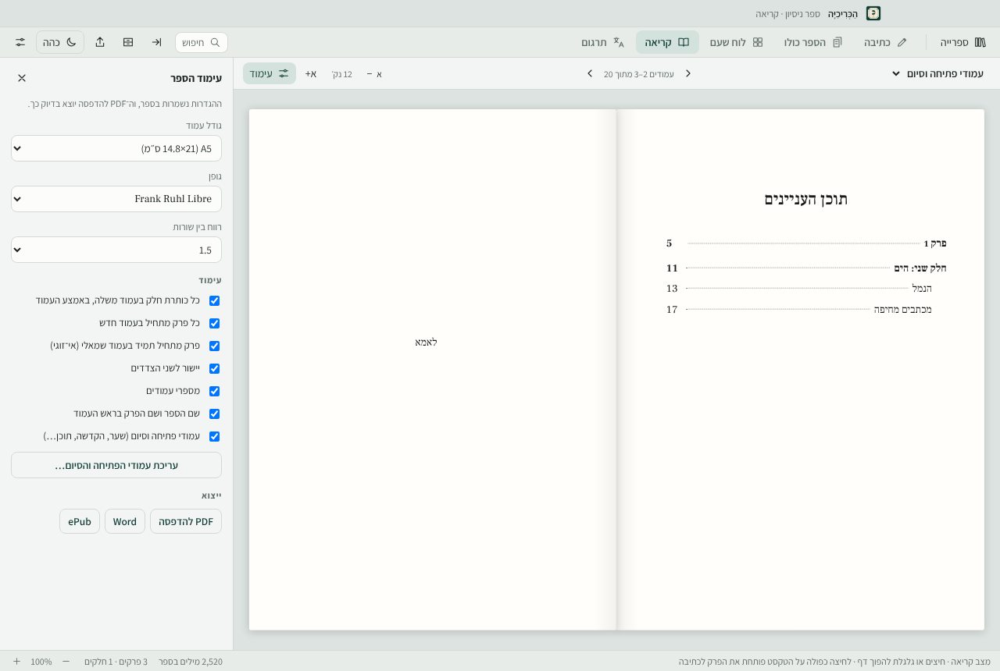
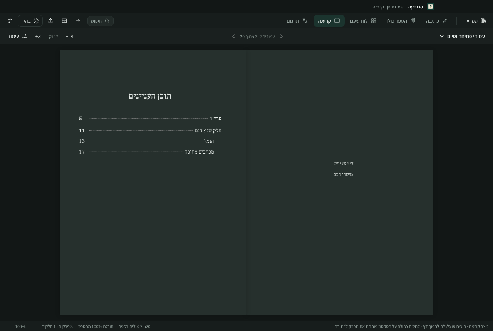
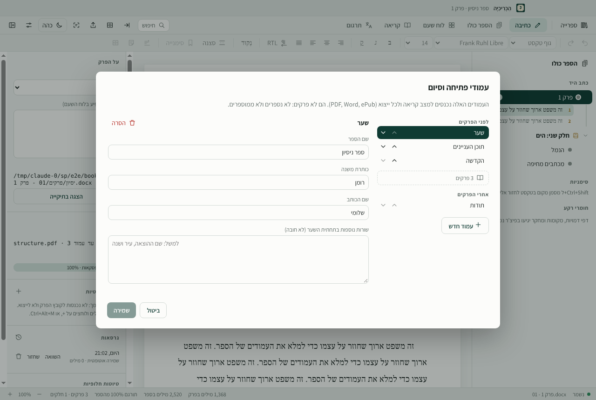

## קיצורי מקלדת כמו ב-Word

| קיצור | פעולה |
| --- | --- |
| Ctrl+R / Ctrl+L | יישור לימין / לשמאל |
| Ctrl+E | מרכוז |
| Ctrl+J | יישור לשני הצדדים |
| Ctrl + Shift הימני | פסקה מימין לשמאל (RTL) |
| Ctrl + Shift השמאלי | פסקה משמאל לימין (LTR) |

## הזחה כמו בספר

כל פסקה מקבלת הזחה בשורה הראשונה, חוץ מהפסקה הראשונה בפרק, הראשונה אחרי כותרת, אחרי שורה ריקה או אחרי שורה ממורכזת (כמו `* * *`). אותו כלל נשמר בקובץ ה-Word: לפסקאות בלי הזחה יש סגנון "First Paragraph".


## לפיתוח

Electron + React + TypeScript, עורך [TipTap](https://tiptap.dev) (ProseMirror). ההמרה ל-docx ובחזרה ב-`src/shared/docx.ts`.

```
npm install
npm run dev        # הרצה בזמן פיתוח
npm test           # בדיקות ההמרה ל-Word
npm run dist:win   # בניית קובץ התקנה (רץ אוטומטית ב-GitHub Actions)
```
